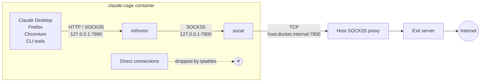

<div align="center">


# claude-cage

**Claude Desktop in a Manjaro KDE container whose only way to the internet is a single SOCKS5 proxy.**

[](LICENSE)
[-informational?logo=linux&logoColor=white)](#requirements)
[](https://docs.docker.com/compose/)
[](https://hub.docker.com/r/manjarolinux/base)
[](https://kde.org/plasma-desktop/)
[](https://github.com/MetaCubeX/mihomo)
[](claude-cage.sh)

[Quick start](#quick-start) •
[Usage](#usage) •
[Examples](#examples) •
[How it works](#how-it-works) •
[Timezone & language](#timezone-language-and-geolocation) •
[Windows](#windows-wsl2) •
[Notes](#notes-and-limitations)

</div>

---

## Overview

`claude-cage` runs [Claude Desktop](https://claude.ai/download) inside a Docker
container with a full Manjaro KDE stack. Claude Desktop is installed from the
AUR package [`claude-desktop`](https://aur.archlinux.org/packages/claude-desktop).
All internet traffic leaves the container through
[mihomo](https://github.com/MetaCubeX/mihomo), which runs inside the same
container and has exactly one upstream: the host's SOCKS5 proxy on port
`7800` (configurable, see [Configuration](#configuration)). Any other
outbound connection is dropped by a firewall.

The container's timezone and language are set explicitly instead of being
inherited from the host, and geolocation and WebRTC leaks are blocked, so
websites cannot recover the host's real position.

## Features

- 🖥️ **Full KDE desktop stack** — Dolphin, Konsole, Kate, Ark, Firefox and
  Chromium, rendered on the host's X11 or Wayland display.
- 🔒 **Single egress path** — mihomo → socat → host SOCKS5; everything else is
  dropped by an `iptables` `OUTPUT` policy.
- 🌎 **Configurable location** — timezone, language and geolocation are set
  explicitly and can be matched to any proxy; see the
  [step-by-step guide](#timezone-language-and-geolocation).
- 🏠 **Isolated home** — a dedicated `./home` instead of your host home;
  only `~/Claude` is shared as a hand-off folder.
- 👤 **Same UID/GID as the host user** — files written by the container belong
  to you.
- 🛡️ **Exit-host hardening** — optional nftables rules for the VPS that hide
  the tunnel from "two-way ping" privacy tests.

## Requirements

- Linux host with Docker Engine and the Docker Compose v2 plugin. On
  Windows, see [Windows (WSL2)](#windows-wsl2).
- An X11 or Wayland desktop session; `xhost` is used on X11.
- A SOCKS5 proxy on host port `7800` (or another port set by
  `HOST_PROXY_PORT`), reachable from the Docker bridge
  (for example a port published by another container). On Linux a service
  bound only to the host's `127.0.0.1` is **not** reachable through
  `host.docker.internal`.
- Several gigabytes of free disk space and direct internet access during
  `docker build`.
- Optional: `/dev/dri` for GPU acceleration.

## Quick start

```bash
git clone https://github.com/ferrobit/claude-cage.git
cd claude-cage

./claude-cage.sh build   # Manjaro KDE + AUR arc-kde-git/claude-desktop (slow the first time)
./claude-cage.sh up      # start the desktop container
./claude-cage.sh claude  # launch Claude Desktop on the host display
```

> [!IMPORTANT]
> Always run Compose through `claude-cage.sh`. The wrapper supplies the build
> arguments, runtime groups and container user that `compose.yml` expects.

## Usage

```text
./claude-cage.sh <command> [arguments...]
```

| Command | Description |
|---|---|
| `build` | Build the `claude-cage` image |
| `up` | Start the desktop container (rebuilds the image when needed) |
| `down` | Stop and remove the container |
| `restart` | Recreate the container |
| `ps` | Show container status |
| `logs` | Follow the logs |
| `claude [args...]` | Launch Claude Desktop on the host display |
| `firefox [args...]` | Launch Firefox |
| `chromium [args...]` | Launch Chromium |
| `dolphin [args...]` | Launch Dolphin |
| `konsole [args...]` | Launch Konsole |
| `kate [args...]` | Launch Kate |
| `shell` | Open an interactive login shell inside the container |
| `run <command...>` | Run a command inside the container (`exec` is an alias) |

GUI commands run detached and return immediately after launching the
application. Use `./claude-cage.sh logs` if an application fails to start.

## Examples

**Check that traffic leaves through the proxy:**

```bash
./claude-cage.sh run ss -ltnp
# 127.0.0.1:7800   socat
# 127.0.0.1:7890   mihomo

./claude-cage.sh run curl -sS https://ifconfig.me
# the public address of your proxy, not the host's own address
```

**Check installed package versions:**

```bash
./claude-cage.sh run pacman -Q arc-kde-git claude-desktop
```

**Hand a file to Claude Desktop:**

```bash
cp ~/Documents/report.pdf ~/Claude/
./claude-cage.sh claude
# In Claude Desktop: attach a file → "Claude (host)" in the sidebar → report.pdf
```

**Update Claude Desktop to the latest AUR version:**

```bash
./claude-cage.sh build --pull --no-cache
./claude-cage.sh restart
```

**Open a shell for troubleshooting:**

```bash
./claude-cage.sh shell
./claude-cage.sh logs
```

## How it works



### What the image contains

- `manjarolinux/base:latest` with the `plasma-meta` KDE desktop stack,
  Dolphin, Konsole, Kate, Ark, Firefox and Chromium.
- `arc-kde-git` and `claude-desktop`, built from the AUR during
  `docker build` with `makepkg` under a throw-away `aurbuild` user. The
  `claude-desktop` PKGBUILD repackages Anthropic's official Debian build, so
  the image always follows the AUR version and no local `.deb` is needed.
- Claude Desktop under `/usr/lib/claude-desktop`, with the package launcher at
  `/usr/bin/claude-desktop`. A wrapper at `/usr/local/bin/claude-desktop`
  (earlier in `PATH`) starts the Electron binary with:
  - `--no-sandbox --no-zygote` — required because Docker blocks unprivileged
    user and PID namespaces here;
  - `--lang=<language>` — the UI language (see
    [Timezone, language and geolocation](#timezone-language-and-geolocation));
  - `--proxy-server=http://127.0.0.1:7890`;
  - `--force-webrtc-ip-handling-policy=disable_non_proxied_udp`.
- Chromium with the package launcher at `/usr/bin/chromium` and a wrapper at
  `/usr/local/bin/chromium` that adds the same `--no-sandbox --no-zygote`,
  `--lang` and WebRTC flags. The proxy comes from a managed policy (see
  [Network model](#network-model)).
- A non-root user whose UID/GID match the host user, so files in `./home` are
  owned by you on the host.
- The static `mihomo` binary copied from `metacubex/mihomo:latest`, plus
  `socat`, the configuration in `mihomo/config.yaml` and the entrypoint in
  `mihomo/entrypoint.sh`. Both helpers start with the container and restart
  automatically if they exit.

### Network model

mihomo is embedded in `claude-cage`: it is not a separate service, and the
container does not join another container's network. No ports are published,
and no extra Docker networks are used.

- `mihomo/config.yaml` defines exactly one proxy, `host-proxy`, a SOCKS5
  upstream at `127.0.0.1:7800`, and the single rule `MATCH,host-proxy`.
  The file is a template: the entrypoint replaces `${HOST_PROXY_PORT}` at
  container start, so the port is set only in `compose.yml`.
- The entrypoint runs
  `socat TCP-LISTEN:7800,bind=127.0.0.1,nodelay ... TCP:host.docker.internal:7800,nodelay`,
  so container loopback port `7800` is the host's published SOCKS5 service.
  `host.docker.internal` is mapped by
  `extra_hosts: host.docker.internal:host-gateway`.
- mihomo listens on the mixed HTTP/SOCKS5 port `127.0.0.1:7890` with
  `bind-address: 127.0.0.1` and `allow-lan: false`, so it is reachable only
  from the container's loopback.
- `ALL_PROXY`, `HTTP_PROXY` and `HTTPS_PROXY` (upper and lower case) point to
  `socks5h://127.0.0.1:7890`, so hostnames are resolved by the proxy and
  mihomo applies its rules.
- The entrypoint installs an `OUTPUT` firewall (the container has
  `cap_add: NET_ADMIN`). It accepts loopback traffic, established replies and
  TCP to the host gateway on port `7800`, and drops everything else. A
  process that ignores the proxy settings cannot fall back to the host's
  internet connection.
- Claude Desktop is started with `--proxy-server=http://127.0.0.1:7890`,
  because Electron/Chromium does not read the proxy environment variables.
  Firefox gets an enterprise policy at
  `/usr/lib/firefox/distribution/policies.json` that sends HTTP and HTTPS to
  the same listener and locks DNS over HTTPS off.
- Chromium gets a managed policy at
  `/etc/chromium/policies/managed/claude-cage.json` that sends all traffic to
  the same listener (`ProxySettings`) and locks DNS over HTTPS and QUIC off.

### Low-latency TCP

Small TCP packets are sent at once on every hop inside the container instead
of being held back and merged:

| Hop | Setting | Where |
|---|---|---|
| application → mihomo (`127.0.0.1:7890`) | `TCP_NODELAY`, set by mihomo (the Go runtime enables it by default) | built in |
| mihomo → socat (`127.0.0.1:7800`) | `TCP_NODELAY` on both ends: mihomo by default, socat by `nodelay` | `mihomo/entrypoint.sh` |
| socat → host SOCKS5 (`host.docker.internal:7800`) | `TCP_NODELAY` by `nodelay` | `mihomo/entrypoint.sh` |
| every TCP socket in the container | `net.ipv4.tcp_autocorking: 0` (no kernel-side merging of small writes) | `compose.yml` → `sysctls:` |

`TCP_NODELAY` turns off Nagle's algorithm, which delays a small packet until
the previous one is acknowledged. Without `nodelay`, the socat hop added about
40 ms to every request made of two small writes. The sysctl is limited to the
container's network namespace; the host keeps its own value. Everything
beyond the host's SOCKS5 port (the proxy itself and its exit server) is
outside the container and is not affected.

Check it:

```bash
./claude-cage.sh run cat /proc/sys/net/ipv4/tcp_autocorking   # 0
./claude-cage.sh run pgrep -a socat                           # ...,nodelay ...,nodelay
```

## Timezone, language and geolocation

The container never inherits the host's timezone or language: both are set
explicitly in the image and in `compose.yml`. Websites compare the timezone,
the language and any geolocation they can read with the location of the IP
address they see, so set these values to match the country of your proxy's
exit address.

> [!NOTE]
> The values that ship with the repository are listed below so you know what
> to search for. Replace them with your own; the example values used in this
> guide are `Europe/Berlin`, `de_DE.UTF-8` and `de-DE`.

### Step 1. Choose the values

| Value | Format | Example | How to find it |
|---|---|---|---|
| Timezone | IANA name | `Europe/Berlin` | `timedatectl list-timezones` on the host |
| System locale | `<lang>_<REGION>.UTF-8` | `de_DE.UTF-8` | `./claude-cage.sh run grep -i de_DE /etc/locale.gen` |
| Language list | `<lang>_<REGION>:<lang>` | `de_DE:de` | built from the locale |
| Browser language tag | `<lang>-<REGION>` | `de-DE` | built from the locale |
| Coordinates (optional) | latitude, longitude | `52.52`, `13.405` | any map service |

### Step 2. Timezone

| File | Setting | What it controls | Shipped value |
|---|---|---|---|
| `compose.dockerfile` | `ENV TZ=…` | image timezone: `/etc/localtime` and `/etc/timezone` are built from `${TZ}` | `America/Sao_Paulo` |
| `compose.yml` | `environment:` → `TZ:` | runtime `TZ` variable (takes precedence over `/etc/localtime`) | `America/Sao_Paulo` |

Keep both values identical. The build checks that
`/usr/share/zoneinfo/${TZ}` exists and stops with an error on a misspelled
name. One command replaces both values:

```bash
sed -i 's|America/Sao_Paulo|Europe/Berlin|g' compose.yml compose.dockerfile
```

### Step 3. Language and locale

Only two variables are set by hand, in two files:

| File | Setting | What it controls | Shipped value |
|---|---|---|---|
| `compose.dockerfile` | `ENV LANG` | system locale of the image | `en_US.UTF-8` |
| `compose.dockerfile` | `ENV LANGUAGE` | message translation order | `en_US:en` |
| `compose.yml` | `environment:` → `LANG` | runtime locale (`LC_ALL` is a YAML alias of it) | `en_US.UTF-8` |
| `compose.yml` | `environment:` → `LANGUAGE` | runtime translation order | `en_US:en` |

Everything else is derived from them, so do not edit it:

| Derived setting | Source | When |
|---|---|---|
| `ENV LC_ALL` | `${LANG}` | build |
| `/etc/locale.gen` entry and `locale-gen` | `${LANG}`; the build fails if `/etc/locale.gen` has no such locale | build |
| `/etc/locale.conf` | `${LANG}`, `${LC_ALL}` | build |
| Firefox policy `"RequestedLocales"` | `${LANG}` → language tag (`de_DE.UTF-8` → `de-DE`) | build |
| Claude Desktop `--lang` | `${LANG}` → language tag | every launch |
| Chromium `--lang` | `${LANG}` → language tag | every launch |
| Chromium policy `"ForcedLanguages"` | `${LANG}` → language tag and base language (`de-DE`, `de`) | build |
| KDE `~/.config/plasma-localerc` | `${LANG}`, `${LANGUAGE}` (seeded by `mihomo/entrypoint.sh`) | first container start |

Keep the values in `compose.dockerfile` and `compose.yml` identical. The
replacement order matters (`en_US:en` first), so use exactly this command:

```bash
sed -i -e 's|en_US:en|de_DE:de|g' -e 's|en_US\.UTF-8|de_DE.UTF-8|g' \
    compose.yml compose.dockerfile
```

For a language other than English, also extend the `pacman -S` list in
`compose.dockerfile`:

- `firefox-i18n-<lang>` (for example `firefox-i18n-de`) — the Firefox
  language pack; without it `RequestedLocales` falls back to English;
- `noto-fonts-cjk` — required for Chinese, Japanese and Korean text.

Optionally, pin the language list that Firefox sends to websites by adding
this entry to the `"Preferences"` block of the Firefox policy:

```json
"intl.accept_languages": {
  "Value": "de-DE, de",
  "Status": "locked"
}
```

### Step 4. Geolocation

By default geolocation is blocked everywhere:

- **Firefox.** The enterprise policy in `compose.dockerfile`
  (`/usr/lib/firefox/distribution/policies.json` in the image) locks these
  preferences:

  | Preference | Locked value | Effect |
  |---|---|---|
  | `geo.enabled` | `false` | no `navigator.geolocation` API |
  | `permissions.default.geo` | `2` | location requests are denied |
  | `media.peerconnection.enabled` | `false` | WebRTC is off, so no address leak |
  | `media.peerconnection.ice.proxy_only` | `true` | WebRTC may only use the proxy |
  | `browser.region.update.enabled` | `false` | no region detection by IP |
  | `browser.region.network.url` | `""` | no region detection service |
  | `network.captive-portal-service.enabled` | `false` | no probes outside the proxy |
  | `network.connectivity-service.enabled` | `false` | no probes outside the proxy |
  | `network.trr.mode` | `5` | DNS over HTTPS is off |

- **Chromium.** The managed policy in `compose.dockerfile`
  (`/etc/chromium/policies/managed/claude-cage.json` in the image) sets:

  | Policy | Value | Effect |
  |---|---|---|
  | `DefaultGeolocationSetting` | `2` | location requests are denied |
  | `WebRtcIPHandling` | `disable_non_proxied_udp` | WebRTC may only use the proxy |
  | `DnsOverHttpsMode` | `off` | DNS over HTTPS is off |
  | `QuicAllowed` | `false` | no QUIC (UDP) connections |
  | `ForcedLanguages` | language tag, base language | `navigator.languages` and `Accept-Language` |

  The wrapper also adds
  `--force-webrtc-ip-handling-policy=disable_non_proxied_udp`.

- **Claude Desktop.** Electron (the framework Claude Desktop is built on) has
  no location source of its own: it needs a Google API key, which is not set.
  The wrapper adds `--force-webrtc-ip-handling-policy=disable_non_proxied_udp`,
  so WebRTC cannot send UDP past the proxy.

Keeping geolocation blocked is the recommended setup. If a site needs a
location, Firefox can report **fixed coordinates** instead. Replace the
`geo.enabled` and `permissions.default.geo` entries in the Firefox policy with
the block below (inside the Dockerfile's `printf` every line stays wrapped in
single quotes):

```json
"geo.enabled": { "Value": true, "Status": "locked" },
"permissions.default.geo": { "Value": 0, "Status": "locked" },
"geo.provider.use_geoclue": { "Value": false, "Status": "locked" },
"geo.provider.network.url": {
  "Value": "data:application/json,{\"location\":{\"lat\":52.52,\"lng\":13.405},\"accuracy\":1000}",
  "Status": "locked"
}
```

> [!CAUTION]
> Never enable geolocation without `geo.provider.use_geoclue: false`. The
> container shares the host's system D-Bus (`/run/dbus/system_bus_socket`),
> so Firefox could ask the host's GeoClue service for the **real** location.

### Step 5. Apply the changes

```bash
rm -f home/.config/plasma-localerc   # let the entrypoint seed the new KDE locale
./claude-cage.sh build
./claude-cage.sh restart
```

`seed_kde_locale` never overwrites an existing `plasma-localerc`, so delete it
first. Restart Claude Desktop, Firefox and Chromium after the container is
recreated.

### Step 6. Verify

```bash
./claude-cage.sh run date                          # local time with the new UTC offset
./claude-cage.sh run cat /etc/timezone             # Europe/Berlin
./claude-cage.sh run readlink -f /etc/localtime    # /usr/share/zoneinfo/Europe/Berlin
./claude-cage.sh run locale                        # de_DE.UTF-8 everywhere
```

In Firefox:

- `about:policies` → the policy is listed as **Active**;
- `about:support` → **Internationalization & Localization** shows the new
  locale;
- in the web console (`Ctrl+Shift+K`):

  ```js
  Intl.DateTimeFormat().resolvedOptions().timeZone  // "Europe/Berlin"
  navigator.languages                               // ["de-DE", "de"]
  "geolocation" in navigator                        // false while geolocation is blocked
  ```

In Chromium:

- `chrome://policy` → the `claude-cage` policies are listed with status **OK**;
- in the DevTools console (`Ctrl+Shift+J`):

  ```js
  Intl.DateTimeFormat().resolvedOptions().timeZone  // "Europe/Berlin"
  navigator.languages                               // ["de-DE", "de"]
  ```

### Limits

- These settings cannot change your public IP address: its geolocation is
  decided by the proxy's exit server.
- Google and similar services can still infer a location from account
  history, cookies or sign-in information. The container home in `./home`
  starts fresh, but signing in carries that history with you; use separate
  accounts if that matters.

## Hiding the tunnel from the exit host

The [2ip.io](https://2ip.io/) privacy test includes a check called
**"Defining tunnel (two way ping)"**. It does not run in the browser: the test
server pings the address it sees (your proxy's public address) and treats an ICMP
echo or timestamp reply as evidence of a tunnel. It also sends OpenVPN-style
UDP probes to well-known ports and treats an ICMP "unreachable" answer as a
sign of a blocking firewall. Nothing inside `claude-cage` can affect those
probes, so the exit VPS silently drops them:

- [`tools/vps/lan-harden.nft`](tools/vps/lan-harden.nft) adds a separate
  nftables table (`inet lan_harden`) that drops inbound `echo-request`,
  `timestamp-request` and `address-mask-request`, plus UDP probes on ports
  `500`, `1194`, `1701`, `1723`, `4500` and `51820`. None of these ports are
  in use; the AmneziaWG endpoint uses another UDP port and stays open.
- [`tools/vps/lan-harden.service`](tools/vps/lan-harden.service) loads that
  table at boot. It never flushes the ruleset, so Docker's tables and the real
  services are untouched.
- [`tools/vps/install-harden.sh`](tools/vps/install-harden.sh) copies both
  files to the VPS over SSH and enables the service.

Install it (and re-apply after rebuilding the VPS):

```bash
KEY=~/.ssh/vps.pem ./tools/vps/install-harden.sh root@<VPS-IP>
```

`KEY` defaults to `tools/vps/vps.pem`; that file is ignored by git, never
commit it. Then check from the host:

```bash
ping -c 2 -W 3 <VPS-IP>                             # 100% packet loss, no reply
./claude-cage.sh run curl -sS https://ipinfo.io/ip  # still <VPS-IP> through the proxy
```

## GUI and home directory

The container has its own home directory: `./home` is mounted at
`/home/$USER`. The host X11/Wayland, D-Bus, audio and GPU devices are shared
with the container. Before launching an application, the wrapper allows the
current host user through `xhost` (X11 only) and exposes the host
`XAUTHORITY` file as a single read-only mount — never the whole home
directory.

Because the home is separate, container applications start with fresh
profiles: the first time you launch Claude Desktop, Firefox or Chromium, you
will need to sign in again. Copy any configuration you want into `./home`
yourself; it stays on the host after the container is removed.

The host's `~/Claude` is the only exception (`CLAUDE_SHARE_DIR` selects
another host folder). It is bind-mounted read-write at the same path
(`/home/$USER/Claude`) and bookmarked as **Claude (host)** in the
standard file dialog (the entry is seeded in `~/.config/gtk-3.0/bookmarks`).
Files placed there on the host can be opened and saved from Claude Desktop; no
other host folder is visible.

> [!TIP]
> To give Claude read-only access to the hand-off folder, change `:rw` to
> `:ro` on the `~/Claude` mount in `compose.yml`.

## Windows (WSL2)

claude-cage also runs on Windows 10 and 11 through WSL2 (Windows Subsystem
for Linux) and Docker Desktop. The container windows open on the Windows
desktop through WSLg, the graphics layer built into WSL. The wrapper detects
WSL by itself and adds `compose.wsl.yml` to every Compose command; nothing has
to be switched by hand.

> [!NOTE]
> Windows support is new. If something does not work, please open an issue
> with the output of `wsl --version`, `docker version` and
> `./claude-cage.sh logs`.

### What changes on Windows

| Part | Linux | Windows (WSL2) |
|---|---|---|
| Windows on screen | host X11/Wayland sockets | WSLg: `/mnt/wslg/.X11-unix` and `/mnt/wslg/runtime-dir` |
| Sound | host PulseAudio/PipeWire socket | WSLg: `/mnt/wslg/PulseServer` |
| GPU | `/dev/dri` | none: WSL2 exposes the GPU as `/dev/dxg`, so rendering is done in software |
| Session D-Bus | host session bus | none |
| System D-Bus | host socket | not shared (replaced by `/dev/null`) |
| Host SOCKS5 proxy | Docker bridge → host port | Docker Desktop → Windows `127.0.0.1:<port>` |
| Shared folder `~/Claude` | `~/Claude` on the host | `~/Claude` inside WSL, or any Windows folder via `CLAUDE_SHARE_DIR` |

All other parts — the image, mihomo, the egress firewall, the timezone and
language settings — are the same as on Linux.

### Step 1. Install WSL and Ubuntu

In PowerShell **as administrator**:

```powershell
wsl --install -d Ubuntu
```

Restart Windows, open **Ubuntu** from the Start menu and create the Linux user.
Then update WSL and check that WSLg is present:

```powershell
wsl --update
wsl --version   # the output must contain a "WSLg version" line
```

### Step 2. Install Docker Desktop

1. Install [Docker Desktop](https://docs.docker.com/desktop/setup/install/windows-install/).
2. Settings → General → enable **Use the WSL 2 based engine**.
3. Settings → Resources → WSL integration → enable **Ubuntu** → Apply & restart.

Check from the Ubuntu terminal (Compose 2.24 or later is required for
`compose.wsl.yml`):

```bash
docker version
docker compose version
```

### Step 3. Clone the repository inside WSL

Run every command from the **Ubuntu terminal**, not from PowerShell, and keep
the repository in the Linux file system:

```bash
cd ~
git clone https://github.com/ferrobit/claude-cage.git
cd claude-cage
```

Do not clone into `C:\` or `/mnt/c/...`: bind mounts from the Windows file
system are much slower, and `./home` needs Linux ownership and permissions.
`.gitattributes` keeps LF line endings in the scripts on any checkout.

### Step 4. Start the SOCKS5 proxy on Windows

Run your SOCKS5 client on Windows with a listener on port `7800` (or set
another port with `HOST_PROXY_PORT`, see [Configuration](#configuration)).
Docker Desktop forwards `host.docker.internal` to the Windows host, so a
listener bound to Windows `127.0.0.1` is enough here — unlike on Linux.

### Step 5. Choose the shared folder

**Option A — a folder inside WSL (recommended).** Keep the default
`~/Claude` in Ubuntu and open it from Windows Explorer:

```text
\\wsl.localhost\Ubuntu\home\<user>\Claude
```

On older Windows 10 builds the path starts with `\\wsl$\` instead. Right-click
the folder → **Pin to Quick access** to keep it one click away, or open it
from the Ubuntu terminal with `explorer.exe ~/Claude`. Files keep Linux
ownership, and access is fast on both sides.

**Option B — a Windows folder.** Point `CLAUDE_SHARE_DIR` at a folder on the
Windows drive, for example `C:\Users\<name>\Claude`:

```bash
mkdir -p /mnt/c/Users/<name>/Claude
echo 'export CLAUDE_SHARE_DIR=/mnt/c/Users/<name>/Claude' >> ~/.bashrc
source ~/.bashrc
./claude-cage.sh up    # recreates the container with the new mount
```

The folder is then an ordinary Windows folder, but access to it from the
container is slower. If Claude Desktop cannot save files there, go back to
option A.

In both cases the folder appears in the container at `~/Claude` and as
**Claude (host)** in the file dialog, exactly as on Linux.

### Step 6. Start with one command

`claude-cage.cmd` starts everything from Windows: it launches Docker Desktop
when it is not running, brings the container up (the first run builds the
image, which takes a while) and opens Claude Desktop. Double-click it in
Explorer, or run it from PowerShell or `cmd`:

```powershell
\\wsl.localhost\Ubuntu\home\<user>\claude-cage\claude-cage.cmd
```

Create a desktop shortcut **Claude (cage)** once, then start from it:

```powershell
\\wsl.localhost\Ubuntu\home\<user>\claude-cage\claude-cage.cmd shortcut
```

Any other arguments go to `claude-cage.sh` unchanged:

```powershell
.\claude-cage.cmd chromium   # open Chromium
.\claude-cage.cmd down       # stop the container
.\claude-cage.cmd shell      # shell inside the container
```

The launcher (`claude-cage.ps1`, started by the `.cmd` file) finds the WSL
distribution and the repository path from its own `\\wsl.localhost\...`
location. A copy kept elsewhere on Windows uses `~/claude-cage` in the default
distribution, or the `CLAUDE_CAGE_DISTRO` and `CLAUDE_CAGE_PATH` environment
variables. The same steps work from the Ubuntu terminal:

```bash
./claude-cage.sh up
./claude-cage.sh claude
```

Claude Desktop, Firefox, Chromium and the KDE applications open as separate
windows on the Windows desktop. Check the egress path:

```bash
./claude-cage.sh run curl -sS https://ifconfig.me   # the proxy's address
```

### Limitations on Windows

- **No GPU acceleration.** Video, WebGL and animations use the CPU.
- **No session D-Bus.** KWallet, desktop notifications and tray icons are not
  available; applications fall back to their own storage and behaviour.
- **WSLg is required.** The wrapper stops with an error when
  `/mnt/wslg/.X11-unix/X0` is missing; run `wsl --update` and restart WSL
  with `wsl --shutdown`.
- **Resources.** The first build needs several gigabytes of disk space and
  memory inside the WSL virtual machine; its limits are set in
  `%UserProfile%\.wslconfig`.

## Configuration

| What | Where |
|---|---|
| Upstream SOCKS5 port (`7800`) | `HOST_PROXY_PORT` in `compose.yml`, or at launch: `HOST_PROXY_PORT=1080 ./claude-cage.sh up` |
| Local mixed proxy port (`7890`) | `mihomo/config.yaml`, `compose.yml`, `compose.dockerfile` |
| Timezone, language, geolocation | see [Timezone, language and geolocation](#timezone-language-and-geolocation) |
| Shared host folder (`~/Claude`) | `CLAUDE_SHARE_DIR`, for example `CLAUDE_SHARE_DIR=/mnt/c/Users/<name>/Claude ./claude-cage.sh up` |
| GPU device (`/dev/dri`) | `compose.yml` → `devices:` (removed on Windows by `compose.wsl.yml`) |

If the host's SOCKS5 proxy requires authentication, add the credentials to
`host-proxy` in `mihomo/config.yaml`. `socat` forwards raw TCP, so no other
change is needed:

```yaml
proxies:
  - name: host-proxy
    type: socks5
    server: 127.0.0.1
    port: ${HOST_PROXY_PORT}
    username: <user>
    password: <password>
    udp: false
```

> [!WARNING]
> Do not commit real proxy credentials. Keep them in a local, uncommitted copy
> of the file.

## Notes and limitations

- **Long first build.** The first build downloads a large KDE stack, compiles
  `arc-kde-git` and builds `claude-desktop` from the AUR. Expect a
  multi-gigabyte image. The Dockerfile pins a small set of Manjaro mirrors,
  because the mirror list in the base image can be stale relative to the other
  mirrors (pacman then requests package versions that no mirror still has).
- **Build needs direct internet.** Building `claude-desktop` downloads
  Anthropic's official `.deb` from `downloads.claude.ai` and verifies it
  against the PKGBUILD checksum. The container proxy does not exist yet at that
  point.
- **Persistent home.** `./home` persists across `down`/`up`, and its contents
  are ignored by git.
- **Shared session bus.** Single-instance applications (Dolphin, Kate, …)
  share the host D-Bus session, so launching one from the container may focus
  an already-running host instance instead of opening a second one.
- **Not a sandbox for hostile code.** The container user has passwordless
  `sudo`; this is a convenience setup.
- **Wayland.** `XDG_RUNTIME_DIR`, `/tmp/.X11-unix` and the host Xauthority file
  are used for GUI access. On a pure Wayland session the `WAYLAND_DISPLAY`
  socket is shared through `XDG_RUNTIME_DIR`: Electron, Firefox and Chromium
  use Wayland, while Qt/KDE applications use XWayland (`QT_QPA_PLATFORM=xcb`).
- **Device groups.** The `group_add` GIDs in `compose.yml` default to common
  values. The wrapper overrides them with the host's actual `video`, `render`,
  `audio` and `input` groups, and the image is built with matching GIDs, so
  `docker exec -u` can still open `/dev/dri` and audio devices.
- **No GPU.** On a host without `/dev/dri`, remove the `devices:` entry from
  the `claude-cage` service in `compose.yml`; rendering falls back to
  software.

## Project layout

```text
claude-cage/
├── claude-cage.sh           # host-side wrapper (lifecycle, GUI and shell commands)
├── claude-cage.cmd          # Windows: one-command launcher (double-click)
├── claude-cage.ps1          # Windows: starts Docker Desktop, runs claude-cage.sh in WSL
├── compose.yml              # claude-cage desktop container
├── compose.wsl.yml          # Windows override (WSLg, no /dev/dri), added automatically
├── compose.dockerfile       # Manjaro KDE + AUR arc-kde-git/claude-desktop
├── .dockerignore            # build context: Dockerfile + mihomo/ only
├── .gitattributes           # LF line endings, also on Windows checkouts
├── docs/
│   ├── logo.svg             # project logo (vector)
│   ├── logo.png             # project logo, 512 px raster
│   ├── social-preview.svg   # GitHub social preview source (needs the Inter font)
│   └── social-preview.png   # 1280 × 640 image for Settings → Social preview
├── home/                    # dedicated container home (not the host home)
├── mihomo/
│   ├── config.yaml          # embedded mihomo configuration
│   └── entrypoint.sh        # proxy helpers, egress firewall, desktop seeding
└── tools/vps/               # optional exit-VPS hardening (nftables + systemd)
```

## License

Distributed under the [MIT License](LICENSE).

## Disclaimer

This is an unofficial community project and is not affiliated with or
endorsed by Anthropic. "Claude" is a trademark of Anthropic. Claude Desktop is
downloaded from Anthropic's servers during the build and is subject to
Anthropic's own terms.
